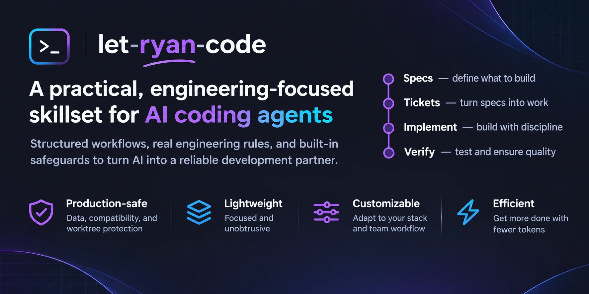
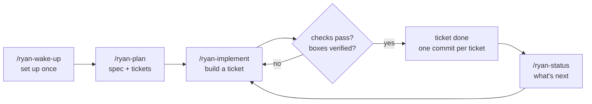

<div align="center">

<a href="https://github.com/tintaungkhant/let-ryan-code">
  
</a>

# let-ryan-code

**Talk to Ryan, your coding agent.**<br>
Agent skills for Claude Code, Codex, OpenCode and Antigravity: a small planner and real engineering rules, distilled from 30 AI-driven projects.

[](https://github.com/tintaungkhant/let-ryan-code/actions/workflows/validate.yml)
[](LICENSE)
[](#commands)
[](#works-with)
[](#benchmark)

[Quick start](#quick-start) · [How it works](#how-it-works) · [Commands](#commands) · [Benchmark](#benchmark) · [What you get](#what-you-get) · [FAQ](#faq)

</div>

---

```bash
npx skills add tintaungkhant/let-ryan-code -g
```

Then, in any project:

```
/ryan-wake-up
```

Ryan reads the project, asks about a dozen setup questions, and writes the agent files. That's it.

## Why Ryan?

Coding agents are fast. Out of the box, they also do this:

| Out of the box, the agent… | With Ryan |
|---|---|
| 📝 **writes a spec when you only asked "what if…?"** | Answers in chat, then asks once: park it, plan it, record a decision, or nothing. |
| 🙋 **asks permission for everything, or for nothing** | Asks you once at setup. For installs, commits, pushes, deploys and paid runs, you answer *yes*, *no* or *flexible*. |
| ✅ **says "done" without proof** | Reports only checks it ran, never weakens a failing test, and leaves a ticket open when a box is not verified. |
| 🔥 **burns tokens** | Loads a rule only when a task touches it, briefs subagents precisely, and turns a 30-question grill into about 10. |
| 🧹 **leaves a mess** | No background dev servers, no detached containers, worktrees only inside the project, a backup before any risky change. |
| 💥 **runs a migration on your real database** | Asks first. Tests never touch a non-test database, send real messages, or move real money. |

Every rule traces to a real project or a decision: see [docs/sources](docs/sources). Nothing is invented.

## How it works



A session looks like this (an illustration, shortened):

```text
you   /ryan-plan add tags to contacts, filterable in the list

ryan  Q1 of ~5. Should a tag be shared across contacts, or free text on each one?
      I recommend shared, so the list can filter by it.
you   shared

ryan  Spec: contact tags (one screen) and 3 tickets:
        01 Tag table and API          blocked by: none
        02 Tags on the contact page   blocked by: 01
        03 Filter the list by tag     blocked by: 02
      Save them?
you   yes

you   /ryan-implement all

ryan  01 done: npm test passed (14 tests), boxes ticked, committed.
      02 done: npm test passed (19 tests), boxes ticked, committed.
      03 done: npm test passed (22 tests), boxes ticked, committed.
      All 3 tickets are done. Nothing is pushed.
```

See the real files Ryan writes on a sample app: [examples/tiny-crm](examples/tiny-crm).

## Quick start

```bash
npx skills add tintaungkhant/let-ryan-code -g
```

Pick your agents when asked. The picker pre-ticks only the agents that share `~/.agents/skills` (Codex, OpenCode, Cursor, …); tick **Claude Code** and **Antigravity** yourself if you use them.

Or skip the picker and name your agents:

| For | Command |
|---|---|
| Claude Code, Codex, OpenCode, Antigravity | `npx skills add tintaungkhant/let-ryan-code -g --skill '*' -a claude-code -a codex -a opencode -a antigravity -y` |
| Claude Code only | `npx skills add tintaungkhant/let-ryan-code -g --skill '*' -a claude-code -y` |
| Codex only | `npx skills add tintaungkhant/let-ryan-code -g --skill '*' -a codex -y` |
| OpenCode only | `npx skills add tintaungkhant/let-ryan-code -g --skill '*' -a opencode -y` |
| Antigravity only | `npx skills add tintaungkhant/let-ryan-code -g --skill '*' -a antigravity -y` |

Drop `-g` to install into the current project instead of globally. Update any time with `npx skills update`.

## Commands

| Command | What Ryan does |
|---|---|
| `ryan-wake-up` | Sets up the project's agent files (`AGENTS.md`, `CLAUDE.md`, `.ai/rules/`, `docs/`) by asking setup questions. |
| `ryan-rethink` | Changes the setup answers; asks only what you want to change and keeps your own edits. |
| `ryan-ship` | Sets up deploys: who deploys, `.ai/deployment.md`, `.ai/credentials.md`. Run it once the app is ready to ship. |
| `ryan-spec` | Asks a few questions (about 10 at most, each with a recommended answer), then writes a one-screen spec. |
| `ryan-tickets` | Splits the spec into a chain of tickets, each one committable on its own. |
| `ryan-plan` | Spec and tickets with one confirmation. Also starts on its own when you ask to plan. |
| `ryan-implement` | Implements a ticket: `ryan-implement 02`, `ryan-implement #12`, `ryan-implement all` for every open ticket in one run, or just `ryan-implement` for the next open one. Follows the project rules, runs the checks, ticks only what it verified. |
| `ryan-remember` | Parks an idea in the backlog, e.g. `ryan-remember CSV import for contacts`. |
| `ryan-status` | Shows where things stand: open tickets, which one is next, and the backlog. Starts nothing. |
| `ryan-talk` | Discusses an idea or a what-if. No spec, no tickets, no files. |

All commands except `ryan-plan` run only when you call them. Install every `ryan-*` skill together: the small commands run flows inside `ryan-wake-up` and `ryan-plan`.

| Tool | How to call a command |
|---|---|
| Claude Code | `/ryan-wake-up` |
| Codex | `$ryan-wake-up` |
| OpenCode | `@ryan-wake-up` |
| Antigravity | `/ryan-wake-up` |

## Benchmark

No skills vs let-ryan-code vs [Matt Pocock's skills](https://github.com/mattpocock/skills), on the same tasks: a fresh copy of a small app for every run, hidden tests run afterwards, 3 runs each, every run published.

| Plan and build a feature with each setup's own commands | ryan | matt |
|---|---|---|
| Codex: fresh tokens (mean) | **130k** | 314k |
| Claude Code: fresh tokens (mean) | **64k** | 185k |
| Hidden tests | 24/24 | 24/24 |

On that structured flow, Ryan used **59% fewer** fresh tokens in Codex and **65% fewer** in Claude Code, with the same test results. The honest part:

- Correctness and safety tie on these tasks: they are too easy to show that rules make code better.
- On small tasks Ryan costs 5k to 11k more tokens, for reading its rules and asking before it commits.
- Fresh tokens are not dollars: cached re-reads still cost something.
- In Claude Code, Ryan and the no-skills setup passed every safety check in all three runs. In one of three Matt runs, the agent ran the migration on the real database without asking.

Full tables, per-run CSVs, method and limits: [Codex](bench/results/2026-11-24-codex.md) · [Claude Code](bench/results/2026-11-24-claude.md) · [run it yourself](bench/README.md).

## What you get

```
AGENTS.md              the single source: rules index, checks, planner, decisions, deploy
CLAUDE.md              @AGENTS.md (Claude Code reads AGENTS.md through it)
.ai/
  rules/
    autonomy.md        what Ryan may do without asking; always-on safety rules
    engineering.md     domain thinking, junior-readable code, packages, validation
    verification.md    honest reporting, tests, real side effects
    git.md             Conventional Commits, staging, secrets, worktrees
    docs.md            keeping docs true, decisions, generated files
  setup-answers.md     your answers, so a re-run asks only what changed
  deployment.md        after ryan-ship: environments, steps, rollback, costs
  credentials.md       after ryan-ship: gitignored, aliases and profiles over raw secrets
docs/README.md
.scratch/              tickets and backlog, if you keep them in local files
```

`AGENTS.md` stays short and is loaded every turn; each rule file is read only when a task touches its topic. Tickets live where you want them: local files, GitHub issues, or another tool.

## Security

- `.env` files are read only if you allow it at setup. Otherwise Ryan works from `.env.example` and the code.
- Deploy credentials live in a gitignored file, are read only for deploy tasks, never printed, and never passed to subagents. Logged-in CLIs, SSH aliases and profiles are preferred, so a secret never enters the conversation.
- Tests never send real messages, emails or payments, and never touch a non-test database.
- Before committing, Ryan stops if a file holds a secret.

## Works with

| Tool | Status |
|---|---|
| Claude Code | Tested: scenarios 1 to 7 in [tests/scenarios.md](tests/scenarios.md), and the [benchmark](bench/results/2026-11-24-claude.md) on Sonnet, 3 runs each |
| Codex | Tested in the [benchmark](bench/results/2026-11-24-codex.md): setup, plan, `implement all` and plain prompts, 3 runs each |
| OpenCode | Built to the official skill docs; not yet tested |
| Antigravity | Built to the official skill docs; not yet tested |

The files `ryan-wake-up` writes work in all four: Codex, OpenCode and Antigravity read `AGENTS.md` directly, and Claude Code reads it through `CLAUDE.md`.

<details>
<summary><b>How each tool keeps commands user-only</b></summary>

| Tool | Mechanism |
|---|---|
| Claude Code, OpenCode | `disable-model-invocation: true` in `SKILL.md` |
| Codex | `agents/openai.yaml`: `policy.allow_implicit_invocation: false` |
| Antigravity | No setting exists; each description says "Run only when the user asks for … by name" |

</details>

## FAQ

<details>
<summary><b>Does it work with my stack?</b></summary>

Yes. The rules are about how to work (plan, verify, commit, ask), not about a language. `ryan-wake-up` reads your project and fills in its own checks, such as your test and lint commands.

</details>

<details>
<summary><b>Will it slow me down on small tasks?</b></summary>

A little: about 5k to 11k extra tokens on a small fix, for reading the rules and asking before it commits. You can set commits to *yes* at setup, or later with `ryan-rethink`, and it stops asking.

</details>

<details>
<summary><b>Can I use it with other skills?</b></summary>

Yes. Ryan's commands are user-only, except `ryan-plan`, so they stay out of the way until you call them.

</details>

<details>
<summary><b>Can I edit the rules it writes?</b></summary>

Yes, they are plain Markdown in your repo. `ryan-rethink` keeps your own edits when it changes setup answers.

</details>

## Other ways to install

<details>
<summary><b>From a clone</b> (for contributors: your edits apply at once)</summary>

Link each skill into every tool's global skills folder.

| Tool | Global skills folder |
|---|---|
| Claude Code | `~/.claude/skills/` |
| Codex | `~/.agents/skills/` |
| OpenCode | `~/.agents/skills/` (also reads `~/.claude/skills/`) |
| Antigravity | `~/.gemini/config/skills/` |

Windows (PowerShell, from the repo root; junctions need no admin rights):

```powershell
foreach ($dir in "$HOME\.claude\skills", "$HOME\.agents\skills", "$HOME\.gemini\config\skills") {
  New-Item -ItemType Directory -Force $dir | Out-Null
  foreach ($skill in Get-ChildItem -Directory -Filter "ryan-*" skills) {
    if (-not (Test-Path "$dir\$($skill.Name)")) { New-Item -ItemType Junction -Path "$dir\$($skill.Name)" -Target $skill.FullName | Out-Null }
  }
}
```

macOS / Linux (from the repo root):

```bash
for dir in ~/.claude/skills ~/.agents/skills ~/.gemini/config/skills; do
  mkdir -p "$dir"
  for skill in skills/ryan-*/; do
    name="$(basename "$skill")"
    [ -e "$dir/$name" ] || ln -s "$PWD/skills/$name" "$dir/$name"
  done
done
```

Restart the tool after installing. In Antigravity CLI, `/skills reload` also works.

</details>

## Repo layout

```
skills/ryan-*/     one folder per skill (SKILL.md, agents/openai.yaml, templates/)
examples/          real output on a sample app
tests/             validate.mjs and the test scenarios
bench/             benchmark: no skills vs let-ryan-code vs Matt Pocock's skills
docs/sources/      where each rule comes from (not shipped to agents)
```

## Contributing

1. Edit a skill under `skills/`.
2. Run `node tests/validate.mjs`. It checks that frontmatter parses, names match folders, each tool's user-only settings are in place, links between skills resolve, and every template placeholder has a fill rule. Add `--project <dir>` to also check a project that `ryan-wake-up` set up.
3. Run the affected scenarios in [tests/scenarios.md](tests/scenarios.md).
4. Add a new `ryan-*` skill to the command table above; the validator fails otherwise.
5. Add a line to [CHANGELOG.md](CHANGELOG.md).

Issues and pull requests are welcome, especially results from OpenCode and Antigravity.

---

<div align="center">

**If Ryan saves you a few tokens, or one bad migration, a ⭐ helps other developers find it.**

[MIT](LICENSE) · made by [@tintaungkhant](https://github.com/tintaungkhant)

</div>
